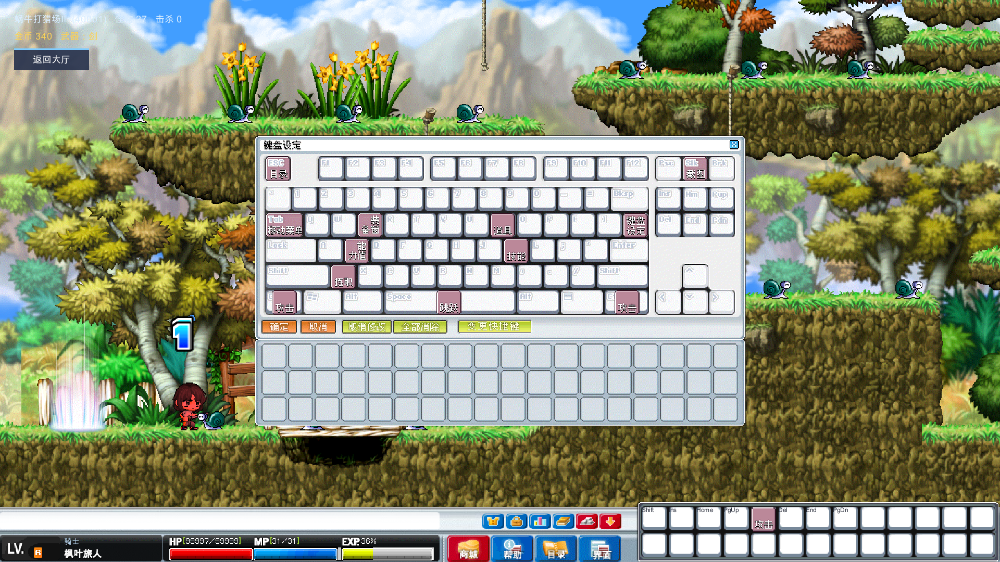
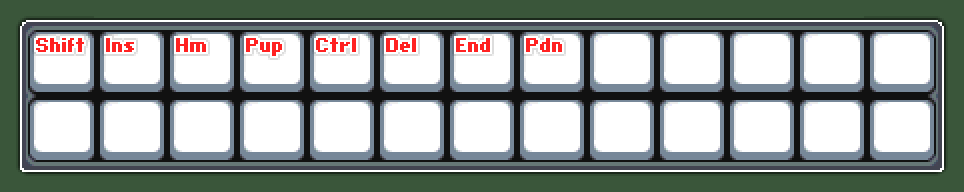
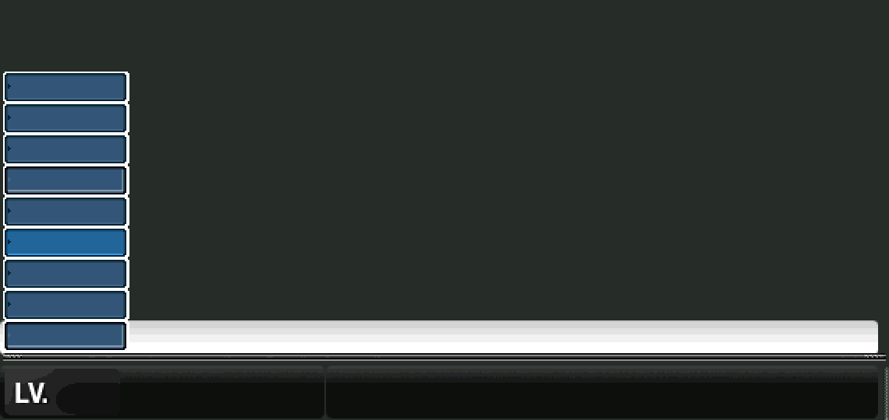

# 原端键盘与底部 HUD 分析（2026-10-22）

本记录替代此前只按 WZ 素材拼接的布局结论。原始客户端只读，没有改动原文件。

## 依据与版本区别

- 客户端：`/Users/lizixian/Documents/mxd/BeiDou-Server/clien/BeiDou.exe`，PE 基址 `0x400000`。
- 实际扩展补丁：同目录 `ijl15.dll`，静态基址 `0x10000000`。必须同时分析补丁，不能只看 exe 的原始 800×600 常量。
- 资源：`clien/Data/UI.wz`，使用项目 WZ reader 读取原始 canvas 和 origin。
- 用户图三：状态区 → 商城/帮助/目录/界面 → 26 格（13×2），六个小入口位于大按钮上方。巨大的 F/W/F2/Enter/Esc 是操作覆盖层，不属于 StatusBar 资源。
- 补丁工程的 `tool/client-debug/weather-compat/src/wvs/wndman.h` 提供九宫格锚点及居中/左下两种配置分支，但缺少 `resolution.cpp` 和实际宏定义，不能把该头文件所有分支当成当前 DLL 都已启用。

反汇编摘录保存在 `Library/HudAnalysis/`（本地分析产物，非运行依赖）。原端字符串池解码后交叉核对资源路径。

## 1. 原始版与扩展版的快捷栏

| 层 | 证据 | 结论 |
| --- | --- | --- |
| exe 原始实现 | `GetShortCutIndexByPos 0x008DE8D5`，表 `0x00BE2DB0` | 8 格，4×2，图标/命中矩形 32×32；格起点 (7,8)，列距35、行距33 |
| 当前 DLL | 安装函数 `0x1000F910` | 将绘制、命中、存储、配置复制长度等改为26，不只是替换一张图 |
| DLL 坐标表 | `0x10036108` | 第一排 x=7+35i、y=8，第二排 y=41，共13列 |
| DLL 宽高补丁 | `0x10010309/0x10010338` 等 | 快捷栏 x 从647改为815；展开 y 从固定值改为屏高+1−80，收起移至屏高+1 |
| WZ | quickSlot08=151×80；quickSlot/quickSlot26=466×80；quickSlot32=571×80 | 存在素材不等于存在对应的分辨率切换代码 |

**在当前 DLL 中没有找到按宽度自动切换 8/26/32 格的逻辑。** `0x1000F910` 固定安装26格补丁。不能臆造 1024→26、1920→32 等断点。服务端 QuickslotBinding 的八键默认值也不能作为扩展26格的完整默认配置。

## 2. 底栏固定分组与尺寸适配

exe 的按钮创建调用可核对 x/y：商城 x573，帮助 x629，目录 x685，界面 x741；y543。六个小按钮 x618+30i、y515。窗口底部基准换算后，大按钮底部贴屏幕下沿，小按钮距下沿62。原图大按钮54×34，小按钮28×20。

| 分组 | 原生像素布局 |
| --- | --- |
| 状态区 | x0，宽570，底部35像素为身份和HP/MP/EXP；完整底图高71，含上部聊天背景 |
| 四大按钮 | x573+56i，y=H−34，54×34；商城、帮助、目录、界面 |
| 六小按钮 | x618+30i，y=H−62，28×20；装备、背包、能力、技能、键盘设置、快捷栏展开/收起 |
| 扩展快捷栏 | x815，y=H−79，466×80；格内32×32 |

原端适配的关键是**固定像素尺寸、固定分组位置、随屏高贴底**。宽屏增加的空间不会被均匀插入状态区与菜单之间，也不会把菜单组挪到屏幕最右边。当前旧实现同时采用720/600缩放、最右锚定菜单、8格上叠和拉伸整条817底图，因而与图三完全不同。

### 本项目小屏兼容（明确不是已确认的原端分支）

原 DLL 的固定 x815/26格布局在不足1281像素的窗口可能超出右边界。项目采用 `min(screenWidth/1281, screenHeight/600)` 整组等比适配；转换为 UiKit 坐标后只应用一次缩放。此前倍率上限为1，造成高分辨率运行画面里的 HUD 和键位窗口过小，现取消该上限。键位窗口共用 HUD 倍率，额外限制窗口不越界。这是本项目的显示适配，不是原 DLL 已证实的分辨率分支。
| 物理尺寸 | HUD像素倍率 | 格数 |
| --- | --- | --- |
| 800×600 | 0.6245（本地兼容） | 26 |
| 1024×768 | 0.7994（本地兼容） | 26 |
| 1280×720 | 0.9992（边框适配） | 26 |
| 1366×768 | 1.0664 | 26 |
| 1920×1080 | 1.4988 | 26 |

## 3. 键盘图标尺寸和托盘规则

- exe `0x00BE27E0` 是按扫描码索引的图标坐标表，键区91项，随后接功能托盘坐标。例：Z=(98,165)、Ctrl=(22,198)、Space=(233,198)。Space 的图标居中，不拉伸铺满长键帽。
- `0x00833A68` 的点击检测为各坐标加32形成矩形；不是当前触屏键帽的28×25区域。
- WZ `KeyConfig/icon` 基本为32×32（个别高31），上下使用相同原生尺寸。旧版 `ScaleToFit(28×25)` 导致上方图标缩小。
- `0x00833DD9` 检查功能占用状态，已分配时跳过托盘绘制；托盘从(9,267)起，列距34、18列，后续行 y301/335。旧版无条件重画 palette 导致重复“拾取”。`0x00836C82` 将托盘序号28..32映射到功能50..54，因此拾取的原生托盘位置是(349,301)，攻击(417,301)，跳跃(451,301)；不能按本地枚举顺序把它们塞进第一排。技能从技能窗配置，不在功能托盘中伪造空槽图标。
- `0x008342A3` 后的绘制分支对Ctrl/Shift/Alt做右侧镜像；`0x008338BF` 将右Shift扫描码归到左Shift。项目同步镜像修饰键图标，并把左右修饰键归为同一功能，触屏和物理键盘使用同一语义。
- 项目设置键盘使用独立 NativeKeyLayout。旧触屏虚拟键盘及其组件、绘制、鼠标模拟、技能拖放和调试入口已删除，仅保留原版键位设置窗口。
- 原端 `OnCreate 0x00832979` 的五个设置按钮都在 y236：确定 x8、取消 x58、取消修改 x112、全部消除 x177、变更快捷键 x260。窗口保持资源的629×373，不再在托盘下面另加26像素假底栏。
- 拖回托盘解除；重绑时清除目标键原动作；确定才保存，取消不改绑定。皮肤文字“取消修改”对应的 BtDefault 实际恢复默认，并非撤销草稿：`OnButtonClicked 0x008335D6` 的2000分支调用 `0x0058E114` 复制固定445字节默认功能表（源0x00BD8BCC），并调用 `0x0072B8E6` 恢复快捷显示默认表；2001分支清空功能表。两者原端都先确认。项目确认框使用原始 Basic/YesNo 与 BtYes/BtNo 资源，操作仍只改草稿，主窗口取消可以放弃。

## 4. 显示键与功能绑定是两张表

原端键位数据是 key→type/action；QuickSlot 另存要显示的物理扫描码。原 exe 析构/配置复制也分别处理89×5字节功能映射和8×4字节快捷显示键；DLL 进一步修改快捷显示数组长度。

项目现在将 QuickBarKeys（26个显示键）与 KeyMap/QuickSlots（按键对应功能/技能）分开：调整显示键不解除 Ctrl 攻击；把技能拖到Ctrl则真正替换Ctrl功能；快捷格从当前按键绑定解析图标、冷却和点击动作。原8个技能保存键名保持兼容，新增技能容量至26。新建默认配置中功能15使用右方括号（服务端扫描码27），不再误用底图的固定Tab键；商城/帮助不默认抢占原端表情的F1/F4。已有保存配置不强制重置，包括用户此前改用Space跳跃等键位。只核实了前8个默认显示键，剩余18格初始不编造映射，可在“变更快捷键”中配置。

原版快捷配置底图仍只有4×2格。为了让项目可配置全部26格，本地增加四页选择及格号提示；这不是声称已还原的原端弹窗交互。取消主窗口也取消显示键和技能的草稿。

## 边界与验证

本次目标为图标大小、托盘重复、底栏结构及对应输入关系；没有实现原端尚缺的完整物品/表情/NPC/坐下/联网聊天等子系统。功能图标只显示已实现动作，避免摆出无法执行的假入口。商城、背包等已有业务骨架未在此重写。

聊天输入只在Enter激活时显示输入控件，避免永久铺出一条假的输入框。本地消息回显并非原端联网聊天。

验证要求：核对原始坐标、所有26格边界、多尺寸倍率、已绑定不显示在托盘、显示键与功能重绑独立、旧存档枚举兼容、确认/取消草稿，以及编辑器实际IMGUI截图。测试需恢复 PlayerPrefs 原始存在状态和值，不能把测试默认值写成用户配置。测试结果随本轮完成后补充。

本轮最终验证：`HudChecks.Run` **223 passed / 0 failed**，测试恢复了所有涉及配置的原始值及不存在状态。实际 IMGUI 截图核实800×600与1366×768的底栏；1366×768下同时核实原生629×373键盘窗口、按钮行、32像素图标和左右修饰键镜像。800归档为底栏裁图，1366归档同时包含最终键盘窗口。原地图运行冒烟正常，无脚本编译错误或运行异常。没有构建APK，没有宣称整套原游戏业务已完整移植。

- [原生尺寸键盘实拍](hud-review/keyboard-1366x768.png)
- [1366×768底栏实拍](hud-review/bottom-1366x768.png)
- [800×600小屏底栏实拍](hud-review/bottom-800x600.png)
- [1366×768完整运行截图](hud-review/game-1366x768.png)

## 运行尺寸反馈修复

取消物理像素倍率上限后，重新运行 HudChecks：223 passed / 0 failed。1920×1080 实际 IMGUI 截图核实键位窗口约943×559，HUD整组约1920像素宽；无脚本编译错误或游戏运行异常。旧虚拟键盘实现和启动入口已删除。

## 左侧身份区参考图修正

用户补充的参考图与当前WZ的黑色LV胶囊皮肤不同。单独重建210×35身份区银色外框，保留原版LV字样和11×13橙色等级数字。等级数字从x42、y11固定起画；职业和昵称共用x88左边线，分别位于y3和y17，均为12px常规浅灰字（#C0C6C8），取消职业蓝色小字和昵称粗体。右侧血蓝经验槽不变。重建方法记录于tools/export_hud.py的identity_plate()，不将该外框冒称为原WZ资源。

1920×1080实际运行以163级核验：三位等级数字完整、职业与昵称左对齐，未出现脚本编译错误或运行异常。

## 2026-10-23 完整默认功能与表情对齐

依据 `GameConstants.java:274–276` 的 DEFAULT_KEY/TYPE/ACTION、BeiDou.exe
`0x00BD8BCC` 的 89×5 字节默认表，以及 `UIWindow.img/KeyConfig/icon`：三者对应的默认功能一致，
共 40 项（type 4：28 项，type 5：5 项，type 6：7 项）。方向键与 Esc 属固定输入，不计入 40 项；
Ctrl/Alt/Shift 的右侧镜像不算新增功能。默认这 40 项均在键盘上，下方托盘为空；解绑才回托盘，
位置固定、不按当前空闲数量重排。托盘 18 列，起点 (9,267)，步长 (34,34)：
功能 0..27 → 序号 0..27，50..54 → 28..32，100..106 → 33..39；表情跨第二、三行。

| 默认键 | 原生功能 ID / 功能 |
| --- | --- |
| E / I / S / K | 0 装备 / 1 道具 / 2 能力值 / 3 技能 |
| R / W / C / M / Q | 4 好友 / 5 大地图 / 6 聊天 / 7 小地图 / 8 任务 |
| 反斜杠 | 9 键盘设定 |
| 1 / H / 2 / 3 | 10 所有人 / 11 悄悄话 / 12 组员 / 13 好友聊天 |
| [ / ] / 单引号 | 14 界面 / 15 快捷键 / 16 对话板 |
| G / 4 / P / L | 17 家族 / 18 家族聊天 / 19 组队 / 20 讯息 |
| 6 / B / 反引号 / 5 | 21 夫妻聊天 / 22 怪物手册 / 23 商城 / 24 联盟聊天 |
| O / F / 分号 | 25 寻找组队 / 26 学院 / 27 勋章 |
| Z / X / Ctrl / Alt / Space | 50 捡取 / 51 坐下 / 52 攻击 / 53 跳跃 / 54 NPC 对话 |
| F1 / F2 / F3 / F4 / F5 / F6 / F7 | 100 受伤 / 101 微笑 / 102 苦恼 / 103 哭泣 / 104 生气 / 105 惊讶 / 106 发呆 |

现在 `NativeKeyActions` 覆盖全部 40 种功能，窗口可显示、拖动、解绑和恢复默认；
表情从真实 Face IMG 与身体帧合成，不替换整个身体动作。基础表情 1..7，持续 5 秒，
节流 1.5 秒，依据 `FaceExpressionHandler` 与 `Character.changeFaceExpression`。
坐下 X 使用原始 sit 动作，移动/跳跃/攻击退出；Space 复用现有 NPC 任务交互。
Q 开任务窗，C 打开本地聊天输入，界面显示可切换。尚无对应业务的地图、社交等功能可配置，
触发时明确提示未开放；未声称其联网系统已完成。

角色选中时读取 DB keymap，类型 1 技能同步到技能绑定；确认键盘设置时写回当前角色。
未实现的物品等 type/action 原样保留，重绑同一按键才替换。修复 Schema 解析器错误跳过
`key INTEGER` 列的问题；旧存档整表缺失有效扫描码时恢复原默认表，主动清空的空表保留。
这取代本文件前面“仅显示已实现功能、未支持表情”的旧范围说明。26 格快捷显示布局维持现有方案，
它与键盘 40 项功能是不同的表，不增加或减少功能数量。

## 2026-10-26 底栏自绘成分清理（键名 / 技能等级 / 底板右段）

用户截图指出底部仍有自绘成分。复查后确认底栏（`BottomBar.cs` / `StatusBar.cs`）只有三处不是原版素材，
本轮全部换成原 canvas 或原字形，并同步参数：

| 位置 | 原实现（自绘） | 现实现（原版素材 + 参数） |
| --- | --- | --- |
| 26 格快捷栏键名 | `GUI.Label` + 运行期字体，字号 8×HUD 倍率，深色文字压在格子上沿 | `UI/UIWindow.img/KeyConfig/key/<扫描码>` 原版点阵字形，贴在格内左上角 `(+1,+1)`，尺寸按 HUD 倍率等比缩放 |
| 快捷格技能等级 | `GUI.Label` 白色 9px 文字，右下对齐 | `UI/StatusBar.img/number/0..9`（5×7）原版数字，6 像素步进，右对齐贴格内右下角 |
| 底板右半段（x>817） | `plate_col` 只裁了 `backgrnd` 的 y36..71 深色 35 行，拉到 71 高会把顶部白色渐变压掉 | `plate_col` 改为整列 `crop [400,0,1,71]`，与左段同一套渐变 |

键名依据：`KeyConfig/key` 是按扫描码索引的完整键名字形表（1-0、字母、F 键、修饰键、Ins/Home/PgUp/Del/End/PgDn 等，
11~13 像素高），`StatusBar.img/key/0..6` 只是其中 7 个的副本。原版键盘底图里所有键名同样贴左上角，
本项目沿用同一套参数 `(+1,+1)`。表里没有字形的键（Esc / Enter / Backspace / Tab / 右键修饰键）
不画名字——不拿自绘文字顶替，这是本轮明确取舍。

映射走 `NativeKeyLayout.ToScanCode`（左 Shift/Ctrl/Alt 归一），字形缓存按 KeyCode 记住，找不到返回 null。

验证：`dotnet build tools/unity-compile-check/Check.csproj` 0 error / 0 warning；
另用 WZ reader 按同一套坐标离线合成预览确认 8 个默认显示键的字形拼版正确。

仍然自绘、本轮未改（等用户确认口径）：聊天历史那层 `UiKit.Fill` 黑色 0.55 底板、
聊天输入框与「收件人」提示文字、状态栏职业/昵称文字（原端也是用字体排版，不是 canvas）。
屏上虚拟按键层属于覆盖层，用户明确要求不动。

> 后续：聊天历史黑底已在下一节去掉；「收件人」在收尾节里挪回白条内；
> 状态栏职业/昵称保留字体排版——原端这两行也是字体，不是 canvas，不算自绘。

## 2026-10-26 聊天区改成原版逻辑（用户口径：一切按原版）

上一条里“聊天仍然自绘”的部分按原版重做。原版聊天区完全落在底板自带的白色条上，
不需要额外的“聊天框”：

| 元素 | 坐标（底板内，570×71） | 来源 |
| --- | --- | --- |
| 白色输入行 | x2..568、y7..28 | `base/backgrnd2` 自带（alpha 从 y7 起 153→255，y28 收尾），不是画出来的 |
| 频道按钮 | (2,7) 81×20 | `base/chatTarget` 深蓝按钮，客户端字符串池里就有这个节点 |
| 输入文字 | (86,7) 448×20 | IMGUI TextField，背景置 null（不铺假输入框）；文字黑色，压在白色条上 |
| 输入行下沿凹线 | (2,28) 566×5 | `base/chat`。宽度 566 正好等于 570−2×2，是这条白色带的下边界 |

聊天记录：**去掉 `UiKit.Fill` 黑色 0.55 底板**，改成原版画法——白字黑描边直接压在画面上，
最多 5 行、行高 14、左对齐 x3。描边用四向 0.5px 偏移各画一遍黑字再画本字。

频道按钮：原先是在原版 `chatTarget` 上面又盖了一个 Unity 默认皮 `GUI.Button`（灰底），
现在只保留原图 + 居中的白色频道名（带描边）。

「收件人」：原版没有额外弹层，悄悄话就是在同一条输入行里先写 `To. 名字 :` 再接正文，
本轮按这个排法把收件人输入框挪回白条内（`To.` 18px + 名字 118px + `:` 12px，正文接在后面），
不再浮在底栏上方压黑字。

验证：`dotnet build tools/unity-compile-check/Check.csproj -t:Rebuild` 0 error / 0 warning；
用 WZ reader 按 (2,7)/(2,28) 在同一张 `backgrnd2` 上叠图核对凹线落点。

## 2026-10-26 收尾：原版行为补全（闪烁 / 经验增量 / 频道下拉）

用户口径是「不要有残留，做完为止」，上一节列在“未做”的原版行为全部补上：

| 原版行为 | 素材 | 参数 |
| --- | --- | --- |
| 掉血闪烁 | `gauge/hpFlash/0`、`/1`（109×18） | 5 帧 × 100ms = 0.5s，0/1 交替，叠在槽体上；只在数值下降时触发，回血/升级不闪 |
| 掉蓝闪烁 | `gauge/mpFlash/0`、`/1`（108×18） | 同上，独立计时 |
| 暂存经验段（2026-10-30纠正旧“经验增量”误解） | `gauge/tempExp`（1×16 浅色条） | 读取Gacha EXP，不是普通获得经验闪条，也没有0.5s寿命；完整证据及整数布局见 `.agents/skills/beidou-client-reverse/references/statusbar-layout.md` |
| 频道下拉 | `UI/Basic.img/ComboBox2` 四态（81×20） | 8 行 × 20px，从按钮下沿往上展开；当前项 pressed、悬停 mouseOver；点空白 / Esc 收起 |

频道按钮本身改回原版专用素材 `base/chatTarget`（81×20）——`BeiDou.exe` 的字符串池里直接引用的
就是这个路径（`UI/StatusBar.img/base/chatTarget`），说明原端就是拿它当聊天目标按钮；
`ComboBox2` 只用在展开后的列表项上（它有 normal/mouseOver/pressed/disabled 四态，能表达选中和悬停）。
`chatTarget` 本身只有一张图，没有悬停态，所以不再伪造 hover 变色。

另外两处去自绘：

- 技能施放失败等即时提示（`GameHUD.DrawNotice`）原来是 `UiKit.Fill` 铺一层 0.65 黑的方框，
  改成原版系统提示的画法：白字 + 四向 0.5px 黑描边，直接压画面，不铺底。这是底栏区域最后一处自绘黑框。
- 聊天历史行、频道名、提示文字统一走同一个 `ShadowLabel`（四向黑描边 + 本字）。

## 原版还有、本端没摆位的素材（不做猜测）

`UI/StatusBar.img` 里以下 canvas 本端没有引用，原因是没有可信的原版坐标，宁可不画也不猜：

- `key/0..6`（Shift/Ins/Hm/Pup/Ctrl/Del/End 字形）、`key/7`（28×20 红色下箭头）：`key/7` 已作为
  `QuickSlotD` 的悬停态使用；`key/0..6` 是旧版键盘提示字形的残留，本端键名走 `KeyConfig/key/<扫描码>`。
- `quickSlot32`（571×80，32 格）、`quickSlot08`（151×80，8 格）：本端按 26 格显示，用 `base/quickSlot`
  （它和 `quickSlot26` 逐像素相同，见 statusbar-layout.md）。
- `FontMemo/0..9`（6×7 点阵）：通知槽的未读计数，反汇编里定位不到绘制位置，不排。

`BtWhisper`（12×19 四态）属于聊天行的悄悄话按钮，但本端不知道它在原版聊天行里的确切 x 坐标
（`chatTarget` 已占到 x2..83，输入行从 x86 起），所以没有插进去——插进去就得编坐标。

## 2026-10-27 底栏对齐源端：坐标复核 + 两处回退

用户指出底栏"有按钮缺失、聊天框样式不对"。按 `BeiDou.exe` 反汇编 + `UI/StatusBar.img`
原始 canvas 重排了一遍，结论落进
[statusbar-layout.md](../.agents/skills/beidou-client-reverse/references/statusbar-layout.md)，
这里只记改了什么。

**几何基线**：客户区 578（不是 600），底栏 817×71 贴底（y=507..578）。
`base/backgrnd2` 画在 **x=2** 而不是 0，所以状态栏底板、白条、深色槽整体右移 2px，
右缘落在 572，正好接上 (573,515) 的通知槽和 (573,543) 的商城按钮。

| 改动 | 之前 | 现在 |
| --- | --- | --- |
| 底板左缘 | `x=0` | `PlateX = 2`（`StatusBar.Panel` 一起跟） |
| 大按钮 | `y=H-62`、高 34 | `y=543`（底栏内 36）、54×34 |
| 小按钮 | 起点 618、`y=H-62` | 起点 618、`y=515`（底栏内 8）、28×20 |
| 聊天输入行 | 宽 448，右边提前 34px 收尾 | 宽 479（x86..565），排到白条右端 |
| 通知槽 | 完全没画 | `base/box` + `base/iconMemo` + `BtClaim`，受 `MemoCount`/`ClaimAvailable` 门控 |
| 空格快捷格 | 铺 `KeyConfigWindow.Icon()` 功能图标 | 只画键名（源端空格就是白底 + 红键名） |
| 按钮四态别名 | `_normal`/`_mouseOver` 误配到 `ani/*` | 强制指向 `normal/0` / `mouseOver/0` |

**两处"加多了"的回退**（本轮先加后删，记下来免得再犯）：

1. `base/box` 一开始按"原端常驻"无条件铺在 (573,515)，结果商城按钮正上方多出两个白方块。
   源端截图该 42×19 区域均值 RGB(215,221,226)、最大值 252，**没有任何 255 白块** ——
   通知槽是有事件才出现的，必须门控。原文「不常驻」的结论是对的，不要推翻它。
2. 通知槽里的未读数：`FontMemo` 点阵的绘制位置在反汇编里定位不到，
   第一版按槽宽自己排了个数字，已删除，只画 `base/iconMemo`。

**验证**：`BottomBar.cs` / `StatusBar.cs` 编译 0 error；用 WZ 原始 canvas 按坐标表离线合成
`Library/SbPreview/native_bar.png`（1281×80，含底栏 + 快捷栏），与源端截图重采样后上下叠图
（`native_vs_src.png`）逐元素对齐：白条右端、6 小按钮、4 大按钮、13×2 快捷格的位置一致，
通知槽区域两侧都是纯底板。

> 注：本轮未能跑 Unity 实机截图——`Assets/Scripts/Server/Bot/BotWander.cs`（未入库的新代码）
> 有 15 个编译错误（`BotCharacter` 缺 `wander`/`moving`/`facing`，`BotScheduler` 缺 `Dt`），
> 导致工程进不了 Play。与底栏无关，等该子系统补完再复跑 `BottomBarReview`。

## 2026-10-27 补：聊天行两态 + 两个通知白槽

用户拿第二张源端截图指出「聊天框收起时的样式不对，右边还缺 2 个按钮」。两张截图
其实是聊天行的**两个不同状态**，之前只实现了输入态。

**聊天行两态**（底色实测见 [statusbar-layout.md](../.agents/skills/beidou-client-reverse/references/statusbar-layout.md)）：

| 状态 | 外观 | 实现 |
| --- | --- | --- |
| 输入态 | 白条 + `chatTarget` 频道按钮 + 输入文字 + `base/chat` 凹线 | `DrawChatInput()`（原逻辑） |
| 收起态 | 深色条（白底压 55% 黑，实测 RGB≈124,117,116）+ 浅色字显示最后一条记录，**无频道按钮** | `DrawCollapsedChat()`（新增） |

收起态的条可点击 → 进入输入态（`FocusChat()`），和原端「点聊天条开始打字」一致。
频道下拉展开时 `ChatFocused` 会被置 false，所以按钮的显示条件写的是
`ChatFocused || channelOpen`，否则列表一展开按钮就消失。

**两个通知白槽**（`base/box` 42×19 @ (573,515)）：

- 左槽 = `BtClaim`（20×19），素材是红圆顶 + 黄底座，与源端截图左槽逐像素吻合
- 右槽 = `base/iconMemo`（14×11 @ (599,519)），橙色口袋 + 蓝宝石，同样吻合

两张截图对"是否常驻"给了相反答案（10-26 那张没有白槽，10-27 那张两个都在）。
**用户拍板按常驻实现**，所以 `DrawNotifyBox()` / `DrawClaim()` 不再加门控；
之前那版 `MemoCount` / `ClaimAvailable` 字段已删除（游戏里没有任何系统写它们）。

**还没做的**：收起态截图右侧、白槽左边还有一个青色四方星按钮和一组竖排 ▲▼ 小箭头。
`UI/StatusBar.img` 里没有对应节点，`UI/Basic.img` 的 `VScr` 一族可能是那组滚动条，
但没有代码引用能坐实，按"不猜"原则先不画，已在文档里记缺口。

2026-10-27 补充（素材排查结果，仍待确认）：

- 位置已反推：以两个白槽（原生 573..615）为基准，星按钮在**原生 x≈549..561**、
  上下箭头在 **x≈561..573**，都在白条右端内部，且画在收起态深色条之上。
- 素材候选：星 = `UI/Basic.img/BtHide2` 或 `BtHide3`（12×12，青蓝底 (88,196,245) +
  白色四角星）；箭头 = `UI/Basic.img/VScr/disabled/prev` + `/next`（12×12，灰底
  (188,188,188) + 白色箭头，源端这两个确实是灰的）。
- `BeiDou.exe` 明文里查不到 `BtHide*` / `VScr` / `BtUP`，但**它们都在加密字符串池里**
  （`BtHide` 2561 / `BtHide2` 2562 / `BtHide3` 2563 / `BtUP` 2598 / `BtDown` 2599）。
  之前"查不到"是因为只搜了明文，结论作废。
- 但"池里有"≠"底栏用了"：`BtHide` 的 10 个 `push 0xa01` 引用点逐个看过，全是别的窗口
  各自的隐藏按钮；`BtHide2`/`BtHide3` 一次 `push` 都没有。所以青色四方星与竖排 ▲▼
  **仍无法坐实是哪两个节点**，按"不猜"原则继续不画，等用户确认后再实现。

## 2026-10-27 补：系统消息按 type 落点

用户要求「系统消息的发送和显示逻辑再细对一下」。查完发现之前最大的偏差是
**把系统消息一律当白色 Toast**，而原端是按包里的 `type` 分三个落点、四种颜色。

完整结论已沉淀到
[chat-and-system-messages.md](../.agents/skills/beidou-client-reverse/references/chat-and-system-messages.md)，
这里只记改动与影响面。

**包结构**：源端只有一个 `SERVERMESSAGE`，首字节 `type`，其后正文。
客户端没有"按 opcode 分流"这回事，必须"读 type 选落点"。

**type 表与落点**（服务端调用数 / 脚本调用数）：

| type | 名称 | 服务端 | 脚本 | 落点 | 语义 |
| --- | --- | --- | --- | --- | --- |
| 0 | `[Notice]` | 15 | 1 | 聊天窗（浅蓝） | 通用公告 |
| 1 | `Popup` | 164 | 18 | **居中弹窗** | 严重错误：背包已满、未知错误 |
| 2 | `Megaphone` | 2 | — | 喇叭 | 跨频道，不接 |
| 3 | `SuperMegaphone` | 4 | — | 超级喇叭 | 跨频道，不接 |
| 4 | `Scrolling` | 0 | 0 | 顶部滚动 | 服务端从未调用，不实现 |
| 5 | `Pink` | 大量 | 143 | 聊天窗（**粉色**） | 阻止 / 失败 |
| 6 | `Lightblue` | 大量 | 73 | 聊天窗（浅蓝） | 条件 / 说明 |

**改动**：

1. 新增 `Assets/Scripts/NativeSystemMessage.cs` —— 唯一分派入口 `Drop(type, text)`。
2. `BottomBar` 的聊天历史从 `List<string>` 改成 `List<ChatLine>`（带 `Color`），
   新增 `AddChat(text, color)` 与 `ChatWhite` / `ChatPink` / `ChatLightBlue`；
   屏幕上画最后 5 行，收起态条里画最后 1 行，**都用该行自己的颜色**。
3. `NpcApi`：`dropMessage` / `playerMessage` / `mapMessage` 三个 API 签名一致，
   统一走 `DropNotice(c)` 按参数个数分流（两参 → 按 type，单参 → type 0）；
   `message(msg)` 硬编码 `Drop(5, …)` —— 源端 `Character.message` 就是 `dropMessage(5, m)`。
4. `NativeSocialWindow`：组队/好友失败改走 `Drop(5, …)`，不再是浮层 Toast。

**两个容易踩错的点**：

- **`[系统]` 前缀不是客户端加的**。`BeiDou.exe` 里 `[系统]` / `系统` / `[组队]` / `所有人`
  在 UTF-16LE / GBK / UTF-8 下全部 0 命中；前缀来自服务端 i18n
  `Message_zh_CN.properties` 第 1107 行。要复现这句话，前缀必须在下发处带。
- **但 type 0 的 `[Notice] ` 前缀是客户端加的**。`0xA22785` 是消息入口（`type = pkt[0]`），
  `0xA229B0` 按 type 跳 14 项表（表在 `0xA236D3`）；case 0 在 `0xA229C0` 处
  `GetString(0x37A)` = `[Notice]` → 拼字面量 `" "`（VA `0xAF1E78`）→ 拼正文。
  已按此实现。
- **`%s : %s` 是"空格冒号空格"**，在 exe 文件偏移 `0x6f1618`（VA `0xAF1618`），
  唯一引用点 `0x45B756`。不是 `%s: %s` 也不是 `%s:%s`。
- 三个聊天落点最终都调 `0x4906B5(文本, 类型号)`：type 0 → 10、type 5 → **12**、type 6 → 10。
  类型号再进 `0x8DB070`（底栏聊天日志）。**10 与 12 就是"浅蓝 / 粉"的区分点**，
  但颜色常量本身还没在绘制函数里定位到。

**验证**：`dotnet build tools/unity-compile-check` 0 error；
`Unity -batchmode -executeMethod BottomBarReview.Run` 新增第 5 张 `bar_5_sysmsg.png`
（白/粉/浅蓝三色混排），与源端 10-27 截图那句 `[系统] 客户端上次闪退…` 上下对照，
同色、同前缀。粉色实测本端字形 RGB(234,192,193)、源端 (204,171,173)（源端是抗锯齿混合值，同族）。

**还没做的**（按「不猜」原则，需用户拍板）：

- **type 1 居中弹窗**现在退回 Toast。素材候选：`UI/Basic.img/Notice/backgrnd`（264×132 单张，
  自带 OK 框）、`Notice2`（258×40/20/47）、`Notice3`（266×21/20/55）、
  `Notice5`（286×22/1/79，origin 在正中 (133,40)，最像"居中弹窗"）。
  池里还有 `DlgNotice`(1232)、`BtOK`(1255/2263)、`BtCancel2`(1258)、`Notice3/t,c,s`(2685-2687)；
  `Notice3` 三段的 `push` 站点 0x515EE2 / 0x515FC5 / 0x5160A8 在同一函数内，
  尾部 0x516337 是 `CreateButton(id, x=205, y=H−30)` + `BtCancel2`，0x516478 又引 `DlgNotice`
  → 那个函数是 `CDlgNotice` 的创建逻辑。但 `Notice/backgrnd`(1914) 找不到干净的 `push 0x77a`
  （唯一命中是 `call` 的地址操作数，假阳性）。**到底复用哪套皮肤、文字区/按钮坐标，仍需用户确认。**
- **type 0/6 的浅蓝**当前取 `#AAD7FF`，只是按类型名 `Lightblue` 推的，没有截图证据。
  扫过 `.text`/`.rdata` 找"按 type 索引的颜色数组"，噪声太大，没定位到。

